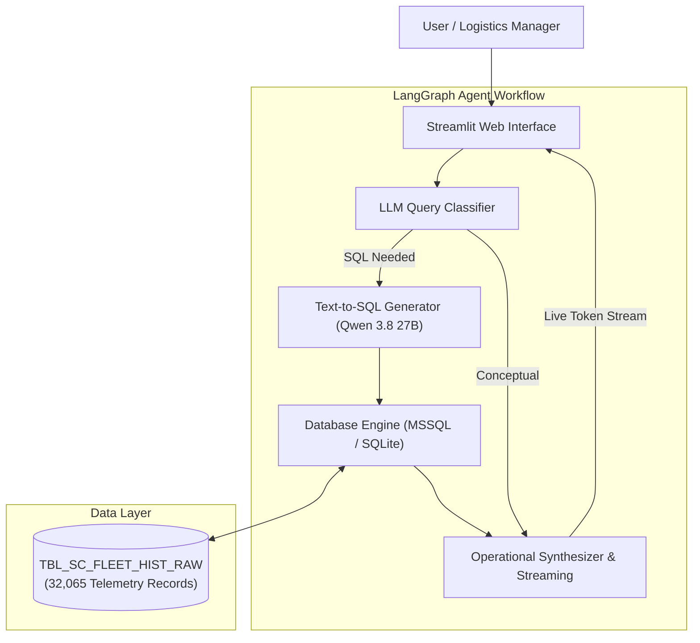

# Supply Chain & Fleet AI Operations Assistant

An enterprise-grade, agentic AI assistant designed to query, analyze, and monitor dynamic logistics operations, fleet telemetry, warehouse performance, and order fulfillment.

Built using **LangGraph**, **Groq (Qwen 3.8 27B)**, **Microsoft SQL Server / SQLite**, and **Streamlit**.

---

## 🌟 Key Features

- **Agentic Text-to-SQL Workflow**: Powered by **LangGraph** to classify intent, generate dialect-safe SQL queries, execute them against enterprise telemetry data, and synthesize operational observations.
- **Streaming Operational Intelligence**: Real-time token streaming with direct answers, root-cause takeaways, and actionable logistics recommendations.
- **Hybrid Database Architecture**: 
  - Native connection to **Microsoft SQL Server (2022)**.
  - Seamless automatic fallback to an embedded **SQLite database (32,065 real-world fleet records)** for zero-cost, 24/7 cloud hosting.
- **Interactive Telemetry & Analytics Dashboard**:
  - **Dynamic Filters**: Filter trips by **Operational Shift** (Shift 1, Shift 2, Shift 3), **Traffic Congestion Index**, and **Equipment Availability**.
  - **Live Visualizations**: Traffic vs. ETA Delay scatter plot, Loading/Unloading time distribution, and Active GPS fleet map.
- **Zero-Cost & Low-Resource Deployment**: Runs entirely on free cloud inference (Groq) with strict token budgeting to eliminate rate-limit errors and zero local GPU requirements.

---

## 🏗️ System Architecture



---

## 📊 Database Schema (`TBL_SC_FLEET_HIST_RAW`)

The system simulates a legacy enterprise ERP/TMS telemetry table:

| Column | Type | Description |
| :--- | :--- | :--- |
| `TS_UTC` | `VARCHAR / DATETIME` | Timestamp in UTC format (`YYYY-MM-DD HH:MM:SS`) |
| `V_LAT` | `FLOAT` | Vehicle GPS Latitude coordinate |
| `V_LON` | `FLOAT` | Vehicle GPS Longitude coordinate |
| `FUEL_CONS_RATE` | `FLOAT` | Vehicle fuel consumption rate (L/hr) |
| `ETA_VAR_HRS` | `FLOAT` | ETA variation in hours (positive = delay, negative = early) |
| `TRF_CNG_LVL` | `FLOAT` | Route traffic congestion index (0 to 10) |
| `WH_INV_LVL` | `FLOAT` | Warehouse inventory stock level |
| `LOAD_UNLOAD_TM` | `FLOAT` | Loading / unloading dwell time in hours |
| `EQ_AVAIL_IND` | `FLOAT / INT` | Material handling equipment availability (1 = Available, 0 = Unavailable) |
| `ORD_FULFILL_STS` | `FLOAT` | Order fulfillment score (1.0 = Fulfilled, <1.0 = Partial/Delayed) |
| `SYS_INGEST_FLAG` | `VARCHAR` | Legacy ingestion flag (`'Y'`) |

---

## 🚀 Local Quickstart

### 1. Clone & Set Up Virtual Environment

```bash
git clone https://github.com/Dharmik-patel1212/supply-chain-AI-assistance.git
cd supply-chain-AI-assistance

# Create and activate virtual environment
python -m venv myenv
# Windows (PowerShell):
.\myenv\Scripts\Activate.ps1
# Mac/Linux:
source myenv/bin/activate
```

### 2. Install Dependencies

```bash
pip install -r requirements.txt
```

### 3. Configure Environment Variables

Create a `.env` file in the project root:

```ini
# Groq Cloud API Key (Free from https://console.groq.com)
GROQ_API_KEY=gsk_your_groq_api_key_here

# Optional: Microsoft SQL Server (defaults to embedded SQLite if not reachable)
SQL_server_HOST=localhost
SQL_server_PORT=1433
SQL_Admin_USER=sa
SQL_Admin_PASSWORD=YourPassword123!
```

### 4. Run the Streamlit Application

```bash
streamlit run app.py
```
Open **`http://localhost:8501`** in your browser.

---

## 🌐 How to Deploy Live on the Internet (Free)

You can host this application 24/7 on **Streamlit Community Cloud** completely free:

### Step 1: Push Code to GitHub
```bash
git add .
git commit -m "Configure production-ready deployment with SQLite and Groq"
git push origin main
```

### Step 2: Deploy on Streamlit Community Cloud
1. Visit **[share.streamlit.io](https://share.streamlit.io)** and sign in with your GitHub account.
2. Click **Create app** &rarr; **Deploy a public app from GitHub**.
3. Select your repository:
   - **Repository**: `Dharmik-patel1212/supply-chain-AI-assistance`
   - **Branch**: `main`
   - **Main file path**: `app.py`
4. Click **Advanced settings...** &rarr; **Secrets**, and paste your Groq API key:
   ```toml
   GROQ_API_KEY = "gsk_your_groq_api_key_here"
   ```
5. Click **Deploy!**

Your live web application will be accessible worldwide via a dedicated link (e.g. `https://supply-chain-ai-assistance.streamlit.app`).

---

## 💬 Example Queries to Test

- **Performance & Shifts**:
  - *"What is the performance metric of Shift 1?"*
  - *"Compare average delay and fuel consumption between Shift 1 and Shift 2"*
- **Fleet Bottlenecks**:
  - *"Show me top 5 routes with highest traffic congestion and delay"*
  - *"What is the average loading/unloading time when equipment is unavailable?"*
- **Operational Synthesis**:
  - *"How does traffic congestion level correlate with order fulfillment?"*
  - *"Provide actionable recommendations to reduce average dwell time across warehouses"*

---

## 🛠️ Tech Stack

- **Framework**: Python 3.12, LangGraph, LangChain
- **LLM Engine**: Groq Cloud (`qwen/qwen3.8-27b` with `openai/gpt-oss-20b` failover)
- **Database**: SQLite (Embedded) & Microsoft SQL Server (Docker / EC2) via SQLAlchemy
- **Data & Visualizations**: Pandas, Altair, Streamlit
- **Embeddings**: Sentence-Transformers (`all-MiniLM-L6-v2`)
